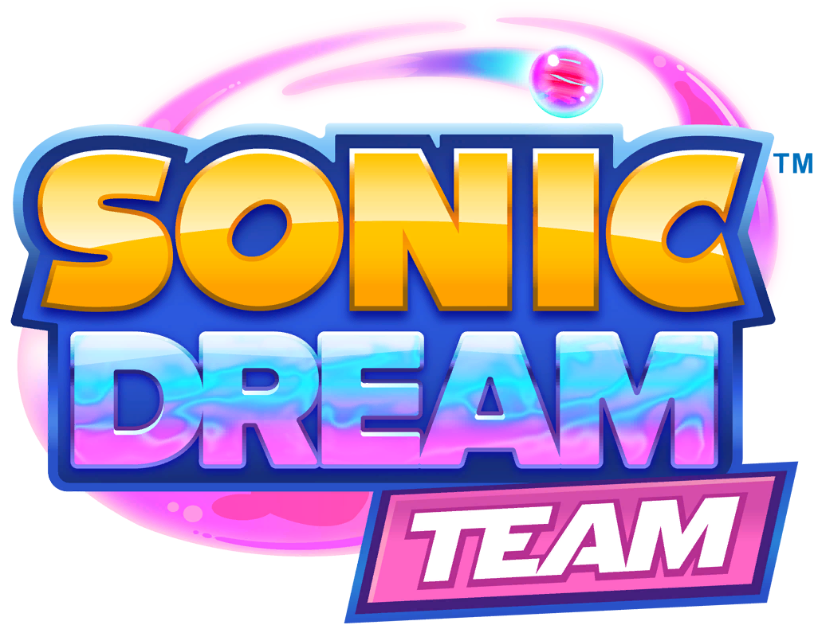
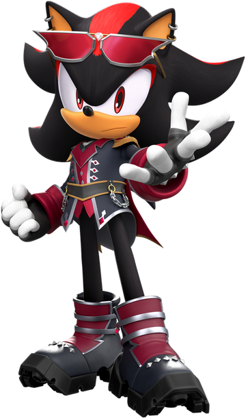
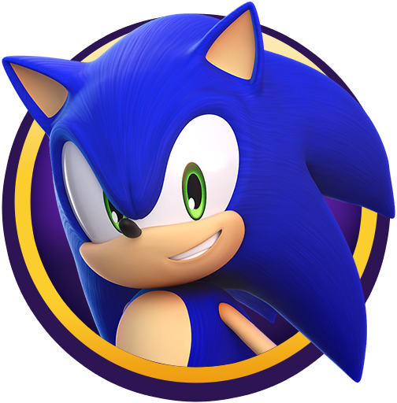

<p align="center">
  
</p>

<p align="center">A save editor for Sonic Dream Team, made for the Project Dream PC port.</p>

It opens the game's save file, shows you what's unlocked in each of the three
slots, and writes your changes back the same way the game does. It's a small
tool with one job.

I built it to learn Raven, the UI toolkit that draws the whole interface. The
editor was the excuse. If you're here for the save format, `crates/sdt-save`
works on its own and doesn't need a window at all.

## What you can edit

- **Savegame**: the saves found in your game folder, one card per slot.
- **Progression**: missions, levels, dream powers, skins, statues, music and
  challenges, each counted against what the game contains.
- **Currency**: the shared XP pool behind the three reward tracks. Add as much
  as you like, or take it back down.
- **Unlocks**: bulk edits for skins, dream powers, collectibles, missions and
  reward-track rewards.
- **JSON**: the save tree as it really is, for anything the editor doesn't
  cover yet.
- **About**: who made it and what it's built with.

Nothing is written until you press **Save**. Every unlock only changes the save
in memory, so you can change your mind as many times as you want.

## Where the save lives



The game keeps it at `PCSaveData/PrimaryHL_Default_Save_ID` inside the install
folder. All three slots live in that one file, as separate properties, so
choosing the install folder is enough. The editor finds the save on its own.

Saving writes the same file the game reads and keeps your previous version as
`PrimaryHL_Default_Save_ID-backup`, which is the name the game uses too. So
there's always a step back.

<br clear="right">

## Building

You need a recent Rust toolchain and
[Raven](https://github.com/ArisSwift/Raven), the UI toolkit the window is made
of. Raven is built from source, and the editor links it by a path, so the two
need to sit beside each other:

```
somewhere/
  Raven/                 the toolkit
  sonic-dream-editor/    this repository
```

Clone [my fork of Raven](https://github.com/ArisSwift/Raven) into `Raven`, build
it once:

```sh
cmake -S Raven -B Raven/build -G Ninja -DCMAKE_BUILD_TYPE=Release \
  -DRAVEN_BUILD_SHARED=ON -DRAVEN_BUILD_TOOLS=OFF -DRAVEN_BUILD_EXAMPLES=OFF
cmake --build Raven/build --parallel
```

Then build the editor. Raven's build folder is the default, so with the two
folders side by side there is nothing to set:

```sh
cargo build -p sdt-editor
cargo build --release -p sdt-editor
```

That default lives in `.cargo/config.toml`. If Raven is somewhere else, say so:

```sh
RAVEN_LIB_DIR=/path/to/Raven/build cargo build -p sdt-editor
```

Run it with the library path, until you copy the library next to the binary:

```sh
LD_LIBRARY_PATH=Raven/build ./target/debug/sdt-editor "/path/to/install"
```

On Windows the library is `raven.dll` in `Raven/build/Release` instead, and it
has to sit next to `sdt-editor.exe` when you run it.

Pass the install folder, the save file, or nothing at all. With nothing, it
looks around for an install itself.

```sh
./target/debug/sdt-editor --help
./target/debug/sdt-editor --self-test /tmp/copy-of-the-save
```

`--self-test` runs the whole chain on a copy with no window: it finds the save,
loads a slot, unlocks skins, gives XP, saves, and then checks that every one of
those actually stuck in the file.

The save core has no dependency on Raven, so its tests run without a build:

```sh
cargo test -p sdt-save
```

To look inside a real save, and confirm the round trip is byte for byte:

```sh
cargo run -p sdt-save --example inspect -- "/path/to/PrimaryHL_Default_Save_ID"
```

## What comes in the archive

Every push is built on Linux and Windows, and a tag attaches both builds to a
release. Grab one from the
[releases page](https://github.com/ArisSwift/SonicDreamEditor/releases/latest).
Each archive is the app on its own: the binary, the Raven library it links, the
assets, and Raven's licence. Unpack it and run it, with no toolkit to install
first.

The Linux build is x86-64 and needs X11 libraries present, which any desktop has.
The Windows build needs the Microsoft C++ runtime, which most machines already
have from something else. If it complains about a missing DLL, that is the one.

## How the save file works


Worth writing down, since it took a while.

The file is a `u32_le` length followed by AES-128-CBC ciphertext. The key is the
first 16 bytes of the base64 of `H4RDl1ght_S4VE`, the IV is `7%o18m'~)mQD%o1`,
and the plaintext is NUL-padded to the next 16-byte block. Both came out of the
game binary.

Inside, the plaintext is text, not binary:

```
<fileType>
<entryCount>
<id>
<value>
... one id/value pair per entry
```

Each slot is one entry holding the game's JSON. The three slot ids are
`3294653793`, `3009895927` and `711855181`, and `3764495936` says which slot the
game used last. Settings, language, game version and notifications sit beside
them as their own entries.

XP is the one part that isn't a plain number. Each track stores a major and a
minor part (`m_spentXP` and `m_spentXPMinor`), scaled by 100, and the reward
screens show one shared balance: everything earned minus everything every track
has spent. Giving XP therefore raises `m_totalStoryMissionXpEarned` rather than
touching the individual tracks. Written this way, the game accepts it and the
tracks stay consistent.

## Repository layout

```
crates/sdt-save      the save format: container, JSON, slot metadata, discovery
crates/sdt-editor    the Raven window: ui.xml, theme.xml, icons, fonts
```

`crates/sdt-save/examples/inspect.rs` is the round-trip check. Everything the
editor shows comes from that crate, so the window is only drawing.

## Status


Working on Linux (CachyOS): save, XP, unlocks, JSON and all six pages. The code
has nothing Linux-only in it and Raven builds for Windows too, but that path
hasn't been built or run yet.

<br clear="right">

## Not affiliated with SEGA or Sonic Team



Sonic Dream Team, its art, its icons and its logo belong to them. Every icon and
the logo in this editor are taken from the game. I'm just a person who wanted
their save file to make sense.

<br clear="right">

## My Socials


- [YouTube](https://www.youtube.com/@Swifty-i4n)
- [TikTok](https://www.tiktok.com/@swiftyaris)
- [Instagram](https://www.instagram.com/eltondavin/)
- [X](https://x.com/SwiftAvos)
- [itch.io](https://arisswift.itch.io/)
- [Discord](https://discord.com/invite/MdXqMPDxnd)
- [GitHub](https://github.com/ArisSwift)

<br clear="right">
